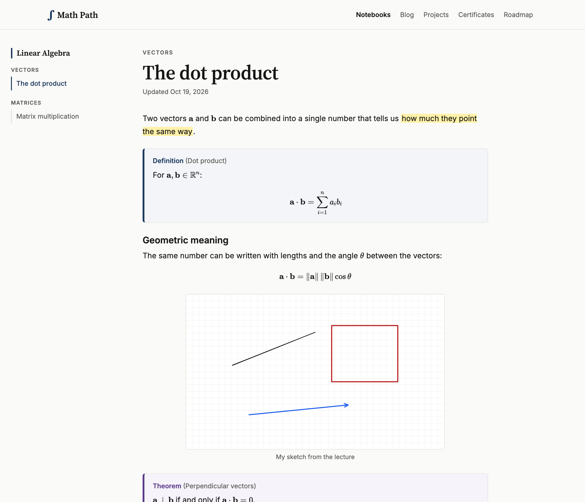
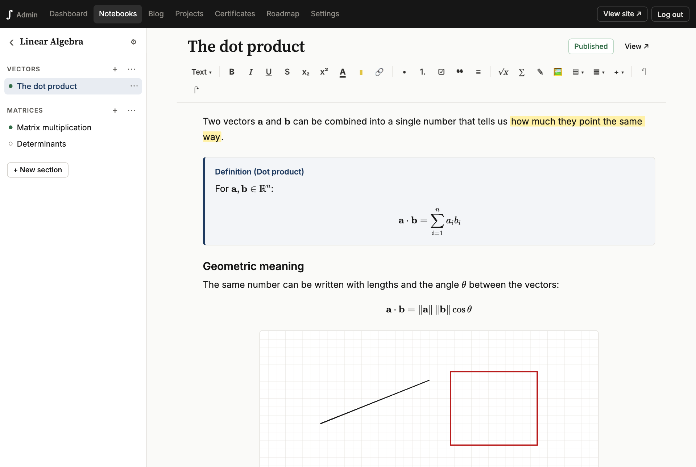
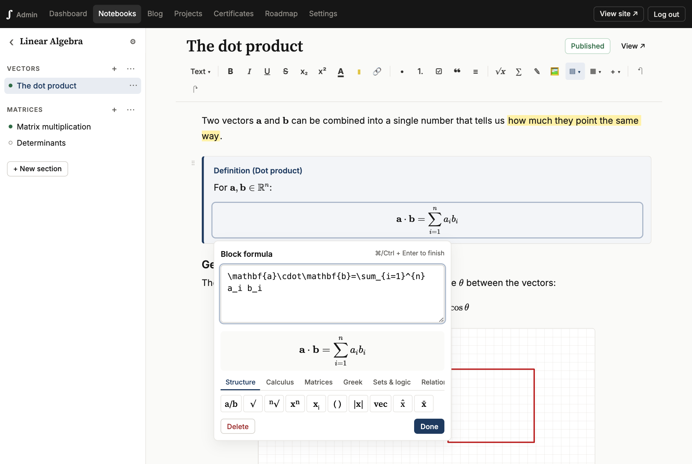
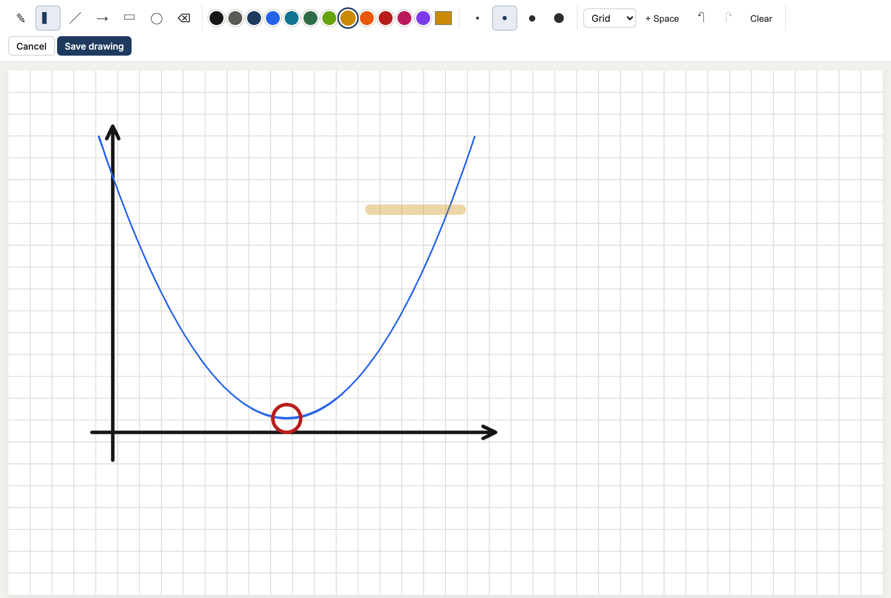
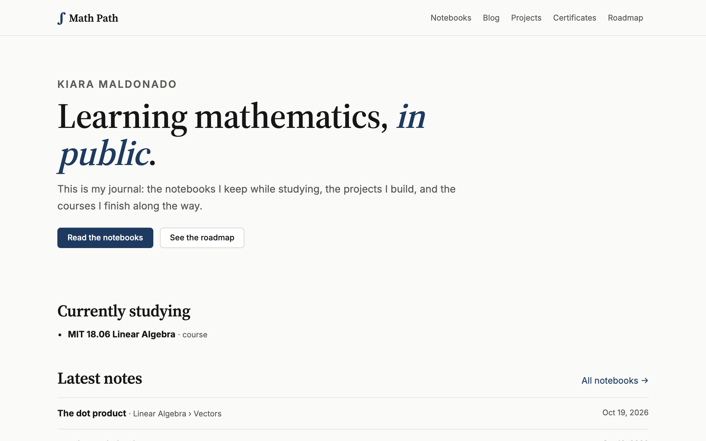
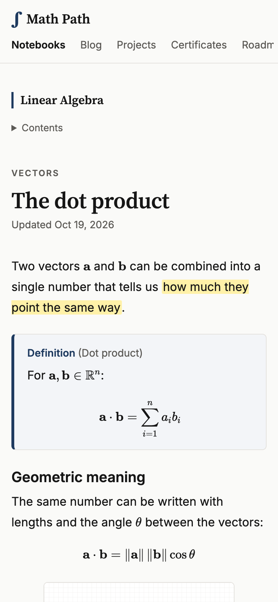

<div align="center">

# ∫ Math Path

**A public journal of my path learning mathematics.**

Notebooks with formulas and hand drawings, blog posts, projects, certificates and a roadmap,
written from a hidden admin that works on any device.

[**math-path.kiaramaldonado.com**](https://math-path.kiaramaldonado.com)

[](LICENSE)
[](COMMERCIAL-LICENSE.md)


</div>



## What it is

I'm (re)learning maths and wanted one place to keep my notes and show the path in public.
Visitors can read everything I publish; I write from a private admin area that only I can reach,
whether I'm on my laptop, my iPad or my phone.

## Features

**Notebooks**
- Notebook → sections → pages, reorderable, with drafts and publishing per page, section and notebook.
- Block editor: headings, colours, highlights, lists, checklists, tables, links (including to your own pages), code.
- **Formulas** in LaTeX, rendered with KaTeX: type `$x^2$` inline or `$$` for a centred equation, with a live preview and a symbol palette.
- **Drawings** in any colour: pen (pressure-sensitive with Apple Pencil), highlighter, lines, arrows, shapes, eraser, grid/graph-paper backgrounds. Editable afterwards.
- Images (paste, drag, or phone camera), Definition / Theorem / Proof / Example boxes, YouTube, Desmos and GeoGebra embeds.
- Type `/` for everything. Autosave, with recovery if the connection drops.

**The rest of the journal**
- Blog posts and projects (same editor, cover images, tags, links).
- Certificates with the PDF or image and a verification link.
- A roadmap of courses, books and topics: now, next and done.
- RSS feed and sitemap.

**Private admin**
- Reachable only through a secret URL; `/admin` and the API answer 404 to everyone else.
- Password + authenticator-app code, rate-limited sign-in, 30-day sessions, "log out everywhere".

## Screenshots

| Editor | Formula editor |
| --- | --- |
|  |  |
| **Drawing canvas** | **Home page** |
|  |  |

<p align="center"></p>

## Tech

- [Astro 5](https://astro.build), server-rendered on [Cloudflare Workers](https://workers.cloudflare.com)
- [D1](https://developers.cloudflare.com/d1/) (SQLite) for content, [R2](https://developers.cloudflare.com/r2/) for images and drawings
- [Tiptap 3](https://tiptap.dev) editor, [KaTeX](https://katex.org) maths, [perfect-freehand](https://github.com/steveruizok/perfect-freehand) strokes
- No front-end framework; plain TypeScript in the browser
- Vitest for tests

## Quick start

```bash
npm install
git config core.hooksPath .githooks
npm run setup-admin -- --local     # password + authenticator QR → .dev.vars
npm run db:migrate:local
npm run dev                        # http://localhost:4321
```

## Documentation

| Doc | For |
| --- | --- |
| [docs/setup.md](docs/setup.md) | Running it locally, commands, troubleshooting |
| [docs/deploy.md](docs/deploy.md) | Cloudflare setup, secrets, custom domain, backups |
| [docs/writing.md](docs/writing.md) | Using the editor: shortcuts, formulas, drawings, publishing |
| [docs/architecture.md](docs/architecture.md) | How the code is organised and how pages are rendered |
| [docs/security.md](docs/security.md) | How the admin area is protected |

## Licence

Copyright © 2026 Kiara Maldonado.

This project is **dual-licensed**:

- **[GNU AGPL-3.0](LICENSE)**: you may use, change and share the code, as long as you keep the
  copyright notice and credit me ([NOTICE](NOTICE)) and release your version as open source under the
  same licence, **including when it only runs as a website**.
- **[Commercial licence](COMMERCIAL-LICENSE.md)**: to use it in closed-source or commercial work,
  contact me to agree terms.

The content published on the site (my notes, posts and drawings) is not part of this repository
and is not covered by this licence. All rights reserved.

Contributions: see [CONTRIBUTING.md](CONTRIBUTING.md). Security reports: see [SECURITY.md](SECURITY.md).
